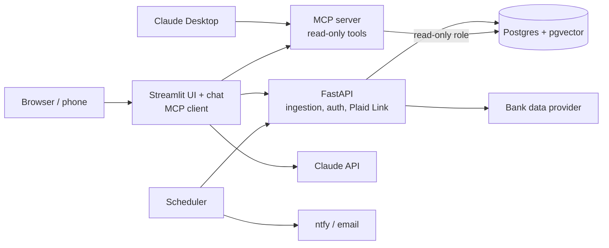

# Budgeter — Project Plan

A self-hosted, AI-assisted personal finance app for a single household: transactions, budgets, net worth and a chat agent that answers questions about your money.

> **Status:** Planning. This document is the source of truth for the build. Features are implemented milestone by milestone against the acceptance criteria below, and the plan is updated before the code whenever scope changes.
>
> Inspired by Monarch Money. Not affiliated with or endorsed by Monarch Money, Inc.

---

## Contents

1. [Goals and non-goals](#1-goals-and-non-goals)
2. [Users and household model](#2-users-and-household-model)
3. [Features (v1)](#3-features-v1)
4. [AI design](#4-ai-design)
5. [Architecture](#5-architecture)
6. [Data model](#6-data-model)
7. [Ingestion and bank connections](#7-ingestion-and-bank-connections)
8. [Security](#8-security)
9. [Testing and CI](#9-testing-and-ci)
10. [Deployment](#10-deployment)
11. [Demo mode](#11-demo-mode)
12. [Milestones](#12-milestones)
13. [Open decisions](#13-open-decisions)
14. [Development workflow](#14-development-workflow)

---

## 1. Goals and non-goals

### Goals

- Track all household accounts in one place: banks, credit cards, brokerages and retirement accounts.
- Show an accurate, near-live net worth, including investment holdings at current market prices.
- Budget by category with planned vs. actual spending each month.
- Answer natural-language questions about spending, budgets and investments, grounded in the user's own data.
- Run entirely on infrastructure the user controls, with a one-command setup.

### Non-goals (v1)

- Multi-tenant hosting or serving more than one household per install.
- Native mobile apps. The UI is a responsive web app usable in a phone browser.
- Moving money: no payments, transfers or trades.
- Agent write access. The AI agent is strictly read-only.

---

## 2. Users and household model

One household per install, with 1–2 users, each with their own login.

- **Shared visibility:** Every user sees all accounts, transactions, budgets and net worth.
- **Personal credentials:** Each user links their own bank logins. Credentials are never visible to the other user.
- **Ownership tags:** Every account is tagged `Mine`, `Partner` or `Joint`, and every view can filter by tag.
- **Permissions:** No admin role in v1. Both users can edit categories, rules and budgets.

**Acceptance:** A second user can log in, see accounts linked by the first user, and filter the dashboard to `Joint` only.

---

## 3. Features (v1)

| # | Feature | Description | Acceptance criteria |
|---|---|---|---|
| F1 | Transactions | List, search and filter transactions across all accounts; edit category, notes and ownership tag. | Filter by date, account, category and merchant; edits persist. |
| F2 | Categorization | Merchant → category rules run first. An LLM categorizes the rest, using similar past transactions as context (RAG). Low-confidence suggestions go to a review queue. | Rules always override the LLM. An approved suggestion can be saved as a rule. Accuracy is tracked by evals. |
| F3 | Transfers, refunds, splits | Transfers between own accounts and credit card payments are excluded from spending. Refunds net against the original category. One transaction can be split across categories. | A card payment never counts as spending. Split amounts must sum to the original. |
| F4 | Budgets | Three budget types: **fixed**, **flexible** and **non-monthly** (e.g. annual insurance). Planned vs. actual per category per month. | The current month shows planned, actual and remaining. Past months are viewable. |
| F5 | Spending charts | Spending by category, by month, and month-over-month trends. | Charts respect ownership filters and exclude transfers. |
| F6 | Net worth | Synced balances + manual assets and liabilities (home, vehicle, loans) + investment holdings × current market prices. | Holdings value refreshes during market hours. Net worth history is charted over time. |
| F7 | Recurring bills | Detects charges that repeat on a regular interval with similar amounts, lists upcoming bills, and flags price increases. | Detects monthly subscriptions in seed data and flags a seeded price increase. |
| F8 | Notifications | Push alerts (via [ntfy](https://ntfy.sh)) for budget overruns and large transactions; a weekly AI-generated summary email. | Thresholds are configurable. The weekly email arrives on schedule. |
| F9 | AI chat | Ask questions in the web app's chat page or from Claude Desktop. | See [AI design](#4-ai-design). |

### History and sync

- One-time import of 3–4 years of history from a Monarch Money CSV export, plus bank CSVs to fill gaps.
- Automatic sync every 3 hours, plus a **Sync now** button.
- Imports are idempotent: re-importing the same data never creates duplicates.

---

## 4. AI design

The agent answers questions by calling a fixed set of **read-only, parameterized tools** exposed by an MCP server. It never writes raw SQL, and it never does arithmetic itself: every number in an answer comes from a tool result.

### Example questions

| Question | How it is answered |
|---|---|
| "My spending went up 20% this month. Where did the extra money go?" | `compare_periods` returns category-level differences between the two months. |
| "How much would I have in 20 years if I keep investing and spending the same?" | Pulls average yearly spend and contributions, then `project_growth` runs a deterministic projection in Python. |
| "Show all my Walmart purchases over the last 6 months." | `search_transactions` uses embedding-based merchant matching, so variants like `WM SUPERCENTER #1234` are included. |

### Tools (initial set)

| Tool | Purpose |
|---|---|
| `spending_by_category` | Category totals for a date range and ownership filter |
| `compare_periods` | Category-level differences between two periods |
| `search_transactions` | Filter by merchant (fuzzy), category, amount and date |
| `get_budget_status` | Planned vs. actual for a month |
| `get_net_worth` | Current net worth and history, by account and owner |
| `get_recurring` | Detected recurring bills and upcoming charges |
| `project_growth` | Deterministic compound-growth projection |
| `search_documents` | Retrieval over the user's uploaded documents |

### Retrieval (RAG) with pgvector

1. **Categorization:** Retrieve the most similar previously categorized transactions before the LLM chooses a category.
2. **Merchant search:** Embed normalized merchant names so one query matches every variant of a merchant.
3. **Personal documents:** Chunk and embed user-uploaded documents (pay stubs, retirement plan documents, goals and notes). Answers cite the chunks they used.

### MCP: one tool server, two clients

- The **MCP server** runs in its own container and connects to Postgres through a **read-only database role**.
- **Claude Desktop** connects to the MCP server directly.
- The **Streamlit chat page** is a custom MCP client that calls the Claude API. It works from any browser, including phones, and it is where call logging and evals run.

### Evals

- **Categorization accuracy** on a labeled set, measured with and without retrieval.
- **Question answering** on a golden set: expected tool calls and expected facts in the answer.
- **Retrieval quality** for document search: whether the correct chunk is returned.
- Evals run in CI against seed data.

### Observability and guardrails

- **Logging:** Every model call records model, input/output tokens, cost, latency, tools called and errors.
- **Input guardrails:** Tool arguments are validated (date ranges, result limits). Write requests and off-topic requests are declined.
- **Output guardrails:** Numeric claims must be traceable to tool results. Answers that cite no tool data are flagged.
- **API key:** Supplied by the user through an environment variable.

---

## 5. Architecture

Five services run in a single Docker Compose stack. Each service has its own Docker image and is configured only through environment variables.



| Service | Responsibility | Exposed to |
|---|---|---|
| **Postgres + pgvector** | Application data and embeddings; schema managed by Alembic | Internal only |
| **FastAPI** | Ingestion and sync, auth, app API, Plaid Link page | Streamlit; Link page in the browser |
| **MCP server** | Agent tools, read-only | Streamlit chat, Claude Desktop |
| **Streamlit** | UI pages and chat (MCP client calling the Claude API) | Users |
| **Scheduler** | 3-hour sync, price refresh, recurring detection, alerts, weekly email | Internal only |

### Tech stack

| Area | Choice |
|---|---|
| Language | Python |
| API | FastAPI |
| Database | PostgreSQL, Alembic migrations, pgvector |
| UI | Streamlit |
| AI | Claude API (tool use), MCP Python SDK |
| Market data | yfinance |
| Notifications | ntfy (push), transactional email service |
| Testing and CI | pytest, GitHub Actions |
| Packaging | Docker, Docker Compose |
| Task runner | Makefile (`make run`, `make test`, `make seed`, `make migrate`) |

### Repository layout

```
.
├── AGENTS.md              # instructions every coding-agent session reads
├── CLAUDE.md              # points Claude Code to AGENTS.md
├── Makefile               # short commands for common tasks
├── docker-compose.yml
├── .env.example
├── pyproject.toml
├── _docs/                 # plan, tasks, process, task template, agent roles
├── src/budgeter/
│   ├── core/              # config, database session, shared models, encryption
│   ├── ingestion/         # providers/, pipeline, normalization, rules
│   ├── api/               # FastAPI app: main, routers/, schemas/, auth
│   ├── mcp_server/        # MCP server and tools/
│   ├── agent/             # agent loop, Claude client wrapper, logging, guardrails
│   ├── scheduler/         # scheduled jobs
│   └── ui/                # Streamlit app, pages/, api_client.py
├── migrations/            # Alembic
├── scripts/               # seed data and one-off utilities
├── evals/                 # eval sets and runners
└── tests/                 # unit/ and integration/
```

Each service (API, MCP server, UI, scheduler) is built from this one codebase with its own Dockerfile or build target.

### Code conventions

- **Layered backend:** routers handle HTTP only, schemas define request and response shapes, business logic lives in service modules, models map to the database.
- **One API client:** the Streamlit UI talks to the backend only through `ui/api_client.py`, never directly to the database. Any future frontend can replace the UI without backend changes.
- **API contract:** FastAPI's generated OpenAPI spec (`/docs`, `/openapi.json`) is the contract between UI and backend.
- **Working increments:** every task ends with something that runs and passes its tests.

### Library defaults

Use these defaults unless this plan is updated. Choices marked "decide at" are made when that milestone starts, by comparing 2–3 options with trade-offs; do not pick them earlier.

| Choice | Default | Rationale | Needed by |
|---|---|---|---|
| Package manager | uv | Fast, lockfile-based, single tool | M1 |
| Lint and format | Ruff | One tool for linting and formatting | M1 |
| ORM | SQLAlchemy 2.0 | Standard Python ORM; native Alembic integration | M1 |
| Scheduler | APScheduler | Runs in-process inside the scheduler container; no extra broker | M3 |
| Auth | Decide at M2 (default candidate: hashed passwords + bearer tokens) | | M2 |
| Embedding model | Decide at M4 | | M4 |
| Email service | Decide at M7 | | M7 |

---

## 6. Data model

Provider data is stored raw, then normalized into application tables. Raw payloads are kept so any sync can be replayed. This is a first draft; it will be refined when the schema is implemented.

| Table | Key fields | Notes |
|---|---|---|
| `users` | id, email, password_hash | 1–2 per household |
| `connections` | id, user_id, provider, encrypted_token, status | One per institution login |
| `accounts` | id, connection_id, name, type, owner_tag, balance | `owner_tag`: Mine / Partner / Joint |
| `raw_transactions` | provider, provider_txn_id, payload (JSON), fetched_at | Unmodified provider data |
| `transactions` | id, account_id, date, amount, merchant_raw, merchant_id, category_id, is_transfer, notes | Unique on (provider, provider_txn_id) |
| `transaction_splits` | transaction_id, category_id, amount | Splits sum to the parent amount |
| `merchants` | id, normalized_name, embedding | pgvector column for fuzzy search |
| `categories`, `category_rules` | name, group; pattern → category | Rules evaluated before the LLM |
| `review_queue` | transaction_id, suggested_category, confidence, status | LLM suggestions awaiting approval |
| `budgets` | category_id, month, type, planned_amount | Type: fixed / flexible / non-monthly |
| `holdings` | account_id, ticker, shares, as_of | From the provider or entered manually |
| `prices` | ticker, price, as_of | From yfinance |
| `manual_assets` | name, type, value, as_of | Home, vehicle, loans |
| `net_worth_snapshots` | date, total, breakdown | For history charts |
| `recurring_series` | merchant_id, interval, expected_amount, next_date | Detected recurring bills |
| `documents`, `document_chunks` | file, chunk_text, embedding | Document RAG |
| `llm_calls` | timestamp, model, tokens_in, tokens_out, cost, latency_ms, tools, status | Observability and eval runs |

---

## 7. Ingestion and bank connections

All data sources implement one **provider interface** and produce the same normalized accounts, transactions and holdings:

- Seed data (synthetic)
- CSV import
- Monarch Money export
- Plaid
- SimpleFIN

### Provider selection

The live bank provider is still open between **Plaid** (free Trial plan) and **SimpleFIN**. The app can use both at once, each covering institutions the other misses.

| | Plaid (Trial plan) | SimpleFIN Bridge |
|---|---|---|
| Cost | Free, up to 10 institution logins | ~$15/year |
| Banks and credit cards | Yes, including major OAuth institutions | Yes; coverage varies by institution |
| Investment holdings | Yes (Investments product) | Yes, where the institution provides them |
| Data freshness | Several refreshes per day (varies by institution) | About once per day |
| Integration | Requires the Plaid Link web widget | Setup token + simple HTTP API |

**Evaluation plan (one evening):**

1. **Plaid first, without using any Trial slots.** Create a Trial account and look up each target institution in the Plaid dashboard to confirm Transactions and Investments support.
2. **SimpleFIN for one month.** Link all target institutions on the SimpleFIN website, run the sample script, and confirm that brokerages return **holdings**, not only balances.
3. **Decide.** Use the provider that covers the most required institutions with holdings, or both.

### Provider rules

- **Plaid**
  - Persist every access token.
  - Repair broken connections with update mode instead of re-linking. Removing an Item does not free a Trial slot.
  - Use the sandbox for all development and testing.
  - Plaid Link is served from a small FastAPI page, since Streamlit cannot host the widget.
- **SimpleFIN**
  - Data refreshes about once per day; stay within ~24 requests per day.
  - Each request covers at most 90 days; overlap fetch windows by a few days.

### Rules for all providers

- Deduplicate on the provider's transaction ID; re-running a sync changes nothing.
- Store raw payloads before normalizing.
- Surface provider errors (expired login, unsupported account) in the UI.

---

## 8. Security

### Read-only by design

- Request only read products: **Transactions, Balance and Investments**. Never request Plaid Auth (account and routing numbers) or any payment or transfer product.
- The app never receives bank or brokerage passwords. Users authenticate through Plaid or SimpleFIN, often on the institution's own site.
- A leaked provider token exposes balances and transactions (a privacy risk) but cannot place trades or move money.
- Any connection can be revoked instantly from the provider's dashboard or the institution's connected-apps settings.
- Users should protect their institution logins with authenticator-app 2FA rather than SMS.

### Application security

- Secrets (API keys, provider tokens, database passwords) live only in environment variables. `.env` is git-ignored and a `.env.example` is committed.
- Provider access tokens are encrypted at rest.
- App login uses hashed passwords, even when the app is only reachable over a private network.
- The agent and MCP server use a read-only database role.
- No real financial data or personal documents are ever committed. Seed data is fully synthetic.

---

## 9. Testing and CI

- **Unit tests (pytest)** for categorization rules, transfer detection, splits, budget math, recurring detection and the projection tool.
- **Integration tests** against a Postgres container loaded with seed data.
- **GitHub Actions** runs linting, tests, Alembic migrations on a fresh database, and the eval suite on every push.

---

## 10. Deployment

The app moves through three stages. Every feature works in all three.

| Stage | Host | Access |
|---|---|---|
| 1. Development | Local machine | [Tailscale](https://tailscale.com) (private network) |
| 2. Always-on | Small VPS | Tailscale (private network) |
| 3. Managed hosting (v2) | [Railway](https://railway.com) | Public HTTPS |

### Portability requirements (from day one)

- All configuration in environment variables; nothing machine-specific.
- Every schema change goes through Alembic.
- One Docker image per service.
- Backups with a tested restore procedure.

### VPS setup

SSH keys, firewall, Docker, Tailscale, secrets, nightly Postgres backups to off-server storage, and an optional GitHub Actions deploy.

### Migration to Railway

- [ ] Back up and restore the database (confirm pgvector support first).
- [ ] Recreate services and environment variables; use private networking so only Streamlit is public.
- [ ] Harden login and add HTTPS and rate limiting for the public URL.
- [ ] Expose the MCP server over authenticated HTTPS so Claude Desktop can still connect.
- [ ] Update Plaid redirect URLs.

---

## 11. Demo mode

Anyone can clone the repository and run the full app on synthetic data with one command. No bank accounts or provider credentials are needed.

```bash
cp .env.example .env    # set DEMO_MODE=true
docker compose up
```

- Loads seeded mock data: multiple accounts, 3+ years of transactions, budgets, holdings and recurring bills.
- Bank sync, notifications and the weekly email are disabled.
- AI chat is disabled unless `ANTHROPIC_API_KEY` is set.
- The same seed data powers the test suite and evals.

---

## 12. Milestones

| Milestone | Delivers |
|---|---|
| **M1 Foundation** | Docker Compose stack, Postgres + Alembic, synthetic seed data generator; `docker compose up` works |
| **M2 Core backend** | Schema, auth, provider interface (seed, CSV, Monarch export), transactions, categories, transfers/refunds/splits, budgets |
| **M3 Bank sync** | Provider evaluation, Plaid and/or SimpleFIN adapter, 3-hour sync, holdings and prices, net worth |
| **M4 AI** | MCP server and tools, Streamlit chat client, RAG (categorization, merchants, documents), eval suite |
| **M5 Observability** | Per-call logging (tokens, cost, latency) and guardrails |
| **M6 UI and CI** | Streamlit pages, full pytest suite, GitHub Actions pipeline |
| **M7 Extras** | Recurring bills, ntfy alerts, weekly email, demo mode, VPS deployment |
| **M8 Managed hosting (v2)** | Railway migration per the checklist in [Deployment](#10-deployment) |

Split transactions and recurring-bill detection are optional in v1 and may be postponed. The task-level backlog lives in `_docs/tasks.md`.

**v2 candidates:** Railway migration (M8) and a mobile-friendly frontend generated with Lovable that calls the same FastAPI backend through the OpenAPI contract, replacing or sitting alongside the Streamlit UI.

---

## 13. Open decisions

- [ ] **Bank provider:** Plaid, SimpleFIN or both (settled by the evaluation plan).
- [ ] **Auth approach** (library vs. custom sessions/JWT), decided at M2.
- [ ] **Embedding model** for pgvector. The Claude API does not provide embeddings; candidates are Voyage AI or a local open-source model.
- [ ] **Email service** for the weekly summary.
- [ ] **Starting category list:** reuse categories from the Monarch export, or define a new set.
- [ ] **Alert thresholds** for large transactions and budget overruns.
- [ ] **Railway pgvector support** (confirm before M8).

---

## 14. Development workflow

This project is built with AI coding agents, using a spec-first workflow. The details live in `_docs/process.md`; agents load them through `AGENTS.md` at the start of every session.

1. **Plan first.** Scope changes are made in this document before any code changes.
2. **Backlog of small tasks.** `_docs/tasks.md` breaks the plan into tasks that each fit one session.
3. **Three agent roles per task:**
   - **PM** grooms the task into goal, acceptance criteria, out of scope and constraints (`_docs/team/pm.md`).
   - **Software Engineer** implements it and writes tests (`_docs/team/software-engineer.md`).
   - **QA** checks every acceptance criterion and returns PASS or FAIL (`_docs/team/qa-engineer.md`). On FAIL, the task goes back to the engineer.
4. **Fresh session per role.** Each role runs in a new session so QA never grades its own work.
5. **Human review.** All agent-generated code is reviewed and understood before a task is closed.
6. **Small commits.** Commit after every meaningful step, referencing the task number.
7. **Living documents.** When an agent needs correcting, the relevant document is updated so the correction sticks.

Tasks run one at a time by hand at first. An orchestrator that drives the whole loop automatically may be added later.
